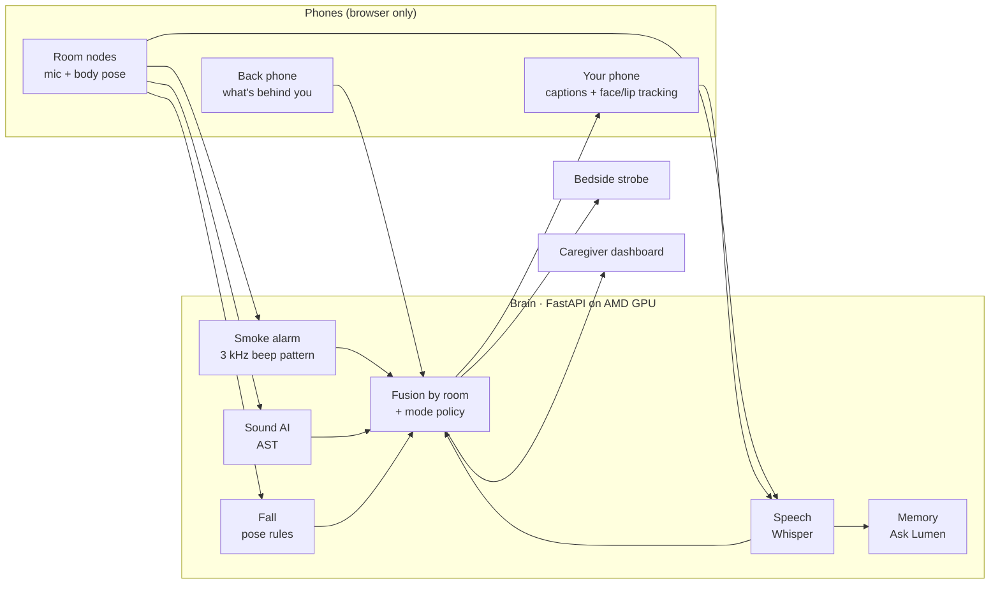
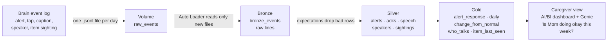
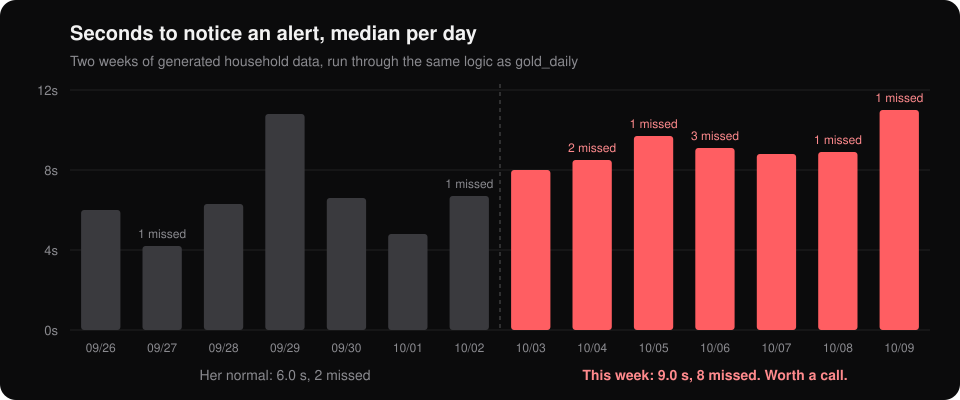

<p align="center">
  
</p>

<p align="center">
  <b>Home safety and live captions for deaf and hard-of-hearing people, built from the phones you already own.</b><br>
  KnightHacks IX · UCF · October 2026
</p>

---

## The problem

Your phone can hear a smoke alarm going off next to it. It has no idea about the one two rooms away while
you're asleep, the doorbell, the kettle, or someone calling your name from the kitchen. Dedicated alert
systems for deaf people cost hundreds of dollars and only cover a few sounds.

## What Lumen does

Lumen turns spare phones into listening nodes around the house, and puts everything they hear on the phone in
your hand.

- **Night mode.** The kitchen phone hears the smoke alarm. The phone on your nightstand strobes red, vibrates
  and flashes its flashlight. No LLM in that path: the alarm detector is plain signal processing, so it can't
  hallucinate.
- **Live captions.** Hold your phone up like a window. Words appear as they're spoken, labeled with whose lips
  were moving, and tagged **TO YOU** when someone is talking to you.
- **Your name.** Lumen alerts you when someone in another room calls your name.
- **Alerts that won't be missed.** Doorbell, timer, glass breaking, a possible fall. Alerts grow on screen
  until you tap them.
- **Ask Lumen.** A memory of what the house heard: "Where are my keys?", "What happened while I was asleep?"
- **Outside mode.** A second phone in your back pocket or bag watches behind you, and a 3D walking view shows
  cars and people coming up on either side.
- **Caregiver dashboard.** A floor plan that lights up the room an alert came from, with a timeline.
- **Change from normal.** Every alert and every tap is logged. A Databricks pipeline compares this week with
  the week before, for the same person, and tells the family when she's taking longer to notice alerts or
  missing more of them. It says "worth a call", never a diagnosis.

<p align="center">
  
</p>

<p align="center">
  
  &nbsp;
  
</p>

## How it works

Every device is just a web page. Open `/node` on a spare phone, `/captions` on yours, `/strobe` on the one by
your bed, and `/dashboard` on a laptop. They all talk to one server (the "brain") over WebSockets.



**No video stream.** Face, pose and object detection run on the phone with MediaPipe. Room phones send audio,
33 body keypoints, and one small still every few seconds so Ask Lumen can remember where your keys are
(turn that off with `?items=0`).

**Modes are config, not code.** Home, Night, Lecture, Outside and Watch are entries in
[`server/app/modes.py`](server/app/modes.py) that decide which detectors run and where each alert goes. You
can also make a new mode by voice.

## How the data flows

Live alerts never wait on the cloud: they're decided on the brain in under a second. Databricks gets the
history, so a caregiver can see slow changes no single alert would show.



| Layer | What it holds | Why |
|---|---|---|
| **Events** | One JSON line per thing that happened, written by [`server/app/eventlog.py`](server/app/eventlog.py) when `EVENT_LOG_DIR` is set | Off by default, so the house forgets on restart unless you opt in |
| **Bronze** | Every line, untouched | Replayable; a new day's file only processes that day |
| **Silver** | One clean table per event type, with expectations that drop impossible rows | Bad data never reaches a caregiver |
| **Gold** | Time to notice each alert, a daily summary, and this week vs. last week | What a family actually asks about |
| **Caregiver view** | A one-page dashboard with an "Ask Genie" box | Plain answers, no SQL |

The headline table is `gold_change_from_normal`. A week is flagged when the median time to notice is more
than 25% slower than the week before, or misses at least double (plus two). Here is what it sees on the two
weeks of sample data in [`databricks/sample_data/`](databricks/sample_data/):

<p align="center">
  
</p>

That slowdown is **planted by our data generator** to show the feature; it is not a real person. The full
setup, including the "a new week arrives" live demo, is in [`databricks/README.md`](databricks/README.md).

## Built with

| Layer | What |
|---|---|
| Compute | **AMD Radeon Cloud** GPU (PyTorch on ROCm) runs the brain and the models |
| Models | **Hugging Face** `MIT/ast-finetuned-audioset` (sounds), `openai/whisper` (speech), `google/owlv2` (where things are) |
| On the phone | MediaPipe Tasks: face landmarks (lip movement), pose, EfficientDet object detection |
| Server | Python, FastAPI, WebSockets |
| Web | React, Vite, Tailwind, Framer Motion, three.js (react-three-fiber) |
| Ask Lumen | Groq by default, swappable to Claude or xAI with one env var |
| History | **Databricks**: Lakeflow declarative pipeline (Bronze/Silver/Gold), AI/BI dashboard, Genie |
| Phones over HTTPS | Cloudflare Tunnel |

## What's built vs. what's tested

We'd rather you hear the limits from us.

| Piece | Built | Tested |
|---|---|---|
| Smoke alarm detector, fall rules, mode routing, memory, event log | ✅ | ✅ 46 automated tests |
| Dashboard, captions, strobe, alerts, Ask Lumen | ✅ | ✅ in the browser, with demo alert buttons |
| Clean UI with calm motion (page fade, panel rise, live pulses) | ✅ | ✅ in the browser |
| AST sound AI, Whisper, OWLv2 on the AMD GPU | ✅ | ⚠️ written against the real models, not yet run end to end on the AMD box |
| 3D walking view, back-phone detection | ✅ | ⚠️ not yet on a real phone; distance is a rough estimate, about ±30% |
| Databricks pipeline, dashboard datasets, Genie setup | ✅ | ⚠️ the change-from-normal math is checked on the sample data above; not yet run on a Databricks workspace |
| Household history | ⚠️ generated, not real | Two weeks of fake events with a planted slowdown |

## Run it

You need Python 3.10+ and Node 18+.

```bash
cd server && pip install -r requirements.txt && cd ..
cd web && npm install && cd ..
bash run.sh
```

Open http://localhost:5173, sign in with your first name, and press a demo alert on the dashboard. Open
`/strobe` in a second tab and tap to arm it to see Night mode fire.

Phones need HTTPS for the camera and mic. `run.sh` starts a Cloudflare tunnel if `cloudflared` is installed
and prints an `https://….trycloudflare.com` link to open on every phone.

### On the AMD Radeon Cloud box

Create the machine with the **PyTorch ROCm** image (you're root, no sudo):

```bash
git clone https://github.com/iKnow24/Aura_KnightHacks && cd Aura_KnightHacks
bash setup.sh
bash run.sh
```

Ask Lumen and the lecture recap pick their AI with `LUMEN_LLM=groq|claude|xai|off` and the matching key
(`GROQ_API_KEY`, `ANTHROPIC_API_KEY`, `XAI_API_KEY`). With no key they fall back to plain rules.

### Tests

```bash
cd server && python -m pytest -q
cd web && npm run build
```

## Repo map

| Path | What it is |
|---|---|
| `server/app/detectors/` | Smoke alarm (DSP), fall, AST sounds, Whisper speech, OWLv2 item sightings |
| `server/app/modes.py` | The modes, as config |
| `server/app/agent.py`, `memory.py` | Ask Lumen |
| `web/src/pages/` | One page per device: Dashboard, Captions, Node, Strobe, Rear, Mic, Headset |
| `server/app/eventlog.py` | Daily event files for Databricks (opt-in) |
| `databricks/` | Pipeline SQL, data generator, sample data, dashboard and Genie setup |
| `docs/demo.md` | The demo script and answers to judge questions |

## Team

Built in one weekend at KnightHacks IX by Sharan ([@iKnow24](https://github.com/iKnow24)) and team.
MIT licensed.
